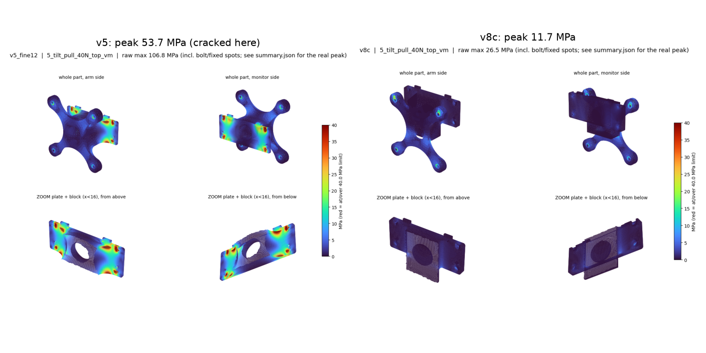

# finite-stress-analysis

Quick, local stress analysis (FEA) for 3D-printed parts, built to be driven by
[Claude Code](https://claude.com/claude-code).

STEP file + a short `part.toml` in → stress heat maps and a pass/fail summary out. It answers
"will this printed bracket break, and where?" before you spend five hours printing it.



*The first project: an HP 32s monitor → VESA adapter. v5 (left) cracked twice at the red
junction. v8c (right) carries the same load at about a fifth of the stress.
See [examples/monitor-mount](examples/monitor-mount/).*

## Install as a Claude Code plugin

Needs [Docker](https://docs.docker.com/get-docker/) running. In any Claude Code session:

```
/plugin marketplace add peterb154/finite-stress-analysis
/plugin install finite-stress-analysis@finite-stress-analysis
```

Then ask things like *"will this bracket hold a 5 kg shelf?"* or *"compare v1 and v2 of my mount"*.
The skill walks Claude through it: get a STEP file, ask you how the part is held and loaded, write `part.toml`,
run coarse then fine, and show you the heat maps. The plugin puts `fsa` on Claude's PATH.

## Use it directly

```sh
git clone https://github.com/peterb154/finite-stress-analysis
cd finite-stress-analysis/examples/monitor-mount
../../bin/fsa run v8c.toml --coarse      # ~20 s sanity check (first run builds the image)
../../bin/fsa run v8c.toml               # fine mesh, a few minutes
../../bin/fsa run v5.toml
../../bin/fsa compare runs/v5 runs/v8c --case tilt_pull_40N_top
```

Each run writes `runs/<name>/` with `summary.json`, heat-map PNGs and `results.vtu` (open in
[ParaView](https://www.paraview.org/) for full 3D inspection). Config format:
[part-toml.md](skills/finite-stress-analysis/part-toml.md).

## How it works

1. **[gmsh](https://gmsh.info/)** meshes the STEP into second-order tetrahedra, finer inside `refine` boxes.
2. **[CalculiX](http://www.calculix.de/)** solves linear static stress for each load case. Supports are fixed
   surfaces. Loads come in through rigid bodies (a monitor, a shelf, a bolt) on the surfaces you pick.
3. fsa reports peak von Mises stress, deflection and **layer tension**: the stress pulling print layers apart,
   checked for each print orientation, because layer adhesion is usually what fails. It also picks the best orientation.
4. Heat maps use a fixed colour scale (red = material limit), so different versions compare at a glance.

Everything runs in Docker with `--network none`, seeing only the current folder.

## Limits

- The material is isotropic with rough FDM strengths (PETG, PLA, ASA, ABS, PA-CF presets). Layer weakness
  is checked after solving, not modelled.
- Linear static only: no creep, impact, snap-fits or large deflections.
- Not calibrated against physical break tests. Trust comparisons between designs more than absolute
  numbers, and keep a 2× or larger margin.

## Development

```sh
uv sync                 # Python deps (pyproject.toml + uv.lock)
uv run pytest           # fast tests
uv run pytest -m slow   # real solver runs in Docker (~1 min)
uv run ruff check . && uv run ruff format --check .
claude plugin validate ./
```

See [CLAUDE.md](CLAUDE.md) for the code layout and rules. A devcontainer is included (with Docker-in-Docker).

## License

[MIT](LICENSE)
